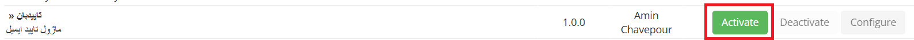
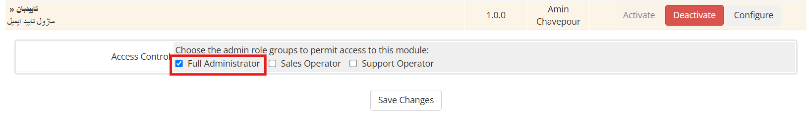

import Tabs from "@theme/Tabs";
import TabItem from "@theme/TabItem";

# نصب و فعال‌سازی

## نصب

### نیازمندیها

- WHMCS ورژن 9 به بالا
- PHP نسخه 8.2 به بالا
- MySQL 5.7 / 8.0
- فعال بودن تایید ایمیل پیشفرض whmcs

پس از دانلود فایل افزونه از سایت، آن را در مسیر `whmcs_dir/modules/addons` اکسترکت نمایید.
وارد صفحه مدیریت WHMCS خود شوید و از بخش افزونه ها افزونه اعلان ساز را فعال نمایید.

سپس از بخش پیکربندی گزینه Full Administrator یا همان مدیر کامل را فعال و ذخیره کنید.

پس از نصب و فعال‌سازی افزونه در منوی افزونه ها روی افزونه میلینو کلیک کنید.

در صفحه باز شده اطلاعات لایسنس خود را در فیلدهای مربوط وارد و فعال کنید.
