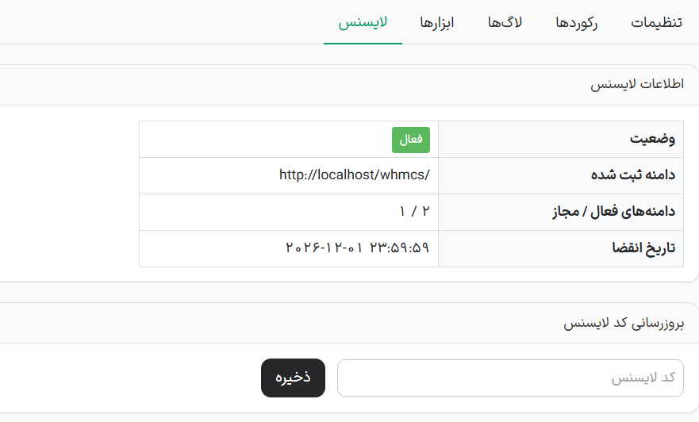

import Tabs from "@theme/Tabs";
import TabItem from "@theme/TabItem";

این بخش شامل لایسنس افزونه است که بعد از فعالسازی وضعیت لایسنس شما نمایش داده میشود

<Tabs>
    <TabItem value="js" label="راست چین">
    
    </TabItem>
    
    <TabItem value="py" label="سایت">
    
    </TabItem>

</Tabs>
