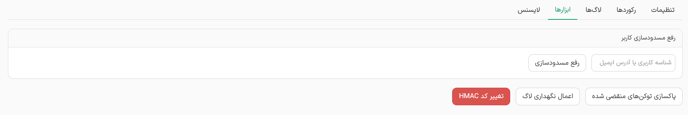

این بخش شامل ابزارهای کاربردی برای نگهداری، بهینه‌سازی دیتابیس است

- **رفع مسدودسازی کاربر:** اگر کاربری به دلیل وارد کردن کدهای اشتباه قفل شده باشد، با وارد کردن ایمیل یا شناسه او در این کادر، می‌توانید قفل حسابش را به صورت آنی باز کنید.
- **پاکسازی توکن‌های منقضی شده:** با کلیک روی این دکمه، تمامی کدهای 6 رقمی و لینک‌های تاییدی که زمان اعتبارشان به پایان رسیده است از دیتابیس حذف می‌شوند تا فضای پایگاه داده بهینه بماند.
- **اعمال نگهداری لاگ:** این ابزار به صورت دستی سیستم پاکسازی لاگ‌ها را بر اساس تنظیماتی که در تب اول (تعداد روزها و سقف لاگ‌ها) مشخص کرده‌اید اجرا می‌کند.
- **تغییر کد امنیتی (HMAC):** این یک ابزار امنیتی پیشرفته است. در صورت مشکوک شدن به نشت اطلاعات، با زدن این دکمه کلید رمزنگاری سیستم تغییر می‌کند. توجه داشته باشید که با این کار، تمامی لینک‌ها و کدهای تاییدی که پیش از این به ایمیل کاربران ارسال شده اما هنوز استفاده نشده‌اند، باطل خواهند شد.
