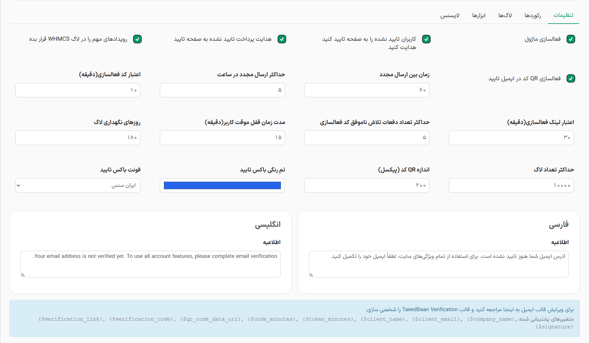

### فعالسازی ماژول

این گزینه کلید اصلی کل ماژول است. اگر این تیک را بردارید، ماژول به طور کامل غیرفعال می‌شود. در این حالت نه تنها هیچ کاربری به صفحه تایید هدایت نمی‌شود، بلکه امکان درخواست ایمیل تایید، تولید کد و ارسال مجدد نیز کاملاً مسدود می‌شود.

### کاربران تایید نشده را به صفحه تایید هدایت کنید

این گزینه صرفاً سیستم هدایت اجباری را کنترل می‌کند. اگر این تیک را بردارید اما تیک **فعالسازی ماژول** روشن بماند، کاربران تایید نشده دیگر به صورت اجباری قفل نمی‌شوند و می‌توانند در ناحیه کاربری آزادانه حرکت کنند. اما ماژول همچنان فعال است، یعنی کاربر می‌تواند با میل خود به صفحه تایید برود، سیستم ایمیل‌ها و کدهای تایید همچنان کار می‌کنند و شما در پنل ادمین به رکوردها و لاگ‌ها دسترسی خواهید داشت.

#### خلاصه کاربرد دو گزینه اول

برای خاموش کردن کامل سیستم تایید‌بان تیک اول را بردارید.\
برای اختیاری کردن تایید ایمیل (بدون قفل کردن اجباری صفحات مشتری) تیک دوم را بردارید.

### هدایت پرداخت تایید نشده به صفحه تایید

اگر این گزینه فعال باشد، کاربرانی که ایمیل خود را تایید نکرده‌اند نمی‌توانند فرآیند پرداخت و ثبت سفارش را تکمیل کنند. سیستم به صورت خودکار کاربر را در سبد خرید متوقف کرده او را برای تایید ایمیل به صفحه تایید‌بان هدایت می‌کند. پس از تایید، کاربر مجدداً به سبد خرید بازگردانده می‌شود.

### رویدادهای مهم را در لاگ WHMCS قرار بده

با فعال‌سازی این گزینه، علاوه بر لاگ‌های اختصاصی خود ماژول، رویدادهای مهم مانند قفل شدن حساب کاربر به دلیل تلاش ناموفق، تایید دستی توسط ادمین و خطاهای سیستم در بخش لاگ WHMCS نیز ثبت می‌شود تا نظارت یکپارچه‌تری داشته باشید.

### فعالسازی QR کد در ایمیل تایید

این ویژگی یک بارکد QR حاوی لینک تایید را در قالب ایمیل ارسالی به کاربر تولید میکند. کاربران می‌توانند به راحتی با اسکن آن توسط موبایل خود، ایمیل را تایید کنند.

### زمان بین ارسال مجدد

مدت زمانی (به ثانیه) که کاربر پس از درخواست کد تایید، باید برای درخواست مجدد صبر کند. این ویژگی از اسپم شدن دکمه **ارسال مجدد** توسط ربات‌ها یا کاربران جلوگیری می‌کند.

### حداکثر ارسال مجدد در ساعت

حداکثر تعداد ایمیل‌های تاییدی که یک کاربر می‌تواند در طول 60 دقیقه درخواست کند. این سیستم برای جلوگیری از مصرف بی‌رویه منابع سرور ایمیل شما و جلوگیری از مسدود شدن IP سرور طراحی شده است.

### اعتبار کد فعالسازی

مدت زمانی (به دقیقه) که کد 6 رقمی ایمیل شده برای کاربر معتبر است. پس از این زمان، کاربر باید کد جدیدی درخواست کند.

### اعتبار لینک فعالسازی

مدت زمانی (به دقیقه) که لینک مستقیم تایید موجود در ایمیل معتبر خواهد بود.

### حداکثر تعداد دفعات تلاش ناموفق

تعداد دفعاتی که کاربر مجاز است کد 6 رقمی را اشتباه وارد کند. پس از عبور از این حد، سیستم برای جلوگیری از حملات حدس زدن کد، کاربر را موقتاً مسدود می‌کند.

### مدت زمان قفل موقت کاربر

مدت زمانی (به دقیقه) که کاربر پس از وارد کردن کدهای اشتباه پی‌در‌پی، در وضعیت مسدود قرار می‌گیرد و نمی‌تواند کد جدیدی وارد یا درخواست کند.

### روزهای نگهداری لاگ

برای جلوگیری از سنگین شدن دیتابیس، ماژول به صورت خودکار لاگ‌های اختصاصی خود را پاکسازی می‌کند. این فیلد مشخص می‌کند لاگ‌ها تا چند روز در دیتابیس باقی بمانند.

### حداکثر تعداد لاگ

علاوه بر محدودیت زمانی، یک سقف عددی نیز برای تعداد رکوردهای جدول لاگ در نظر گرفته شده است تا دیتابیس در سایت‌های پربازدید ایمن بماند.

### اندازه QR کد

ابعاد تصویر تولید شده برای بارکد ایمیل (بر حسب پیکسل). مقدار پیشنهادی 300 پیکسل است.

### تم رنگی باکس تایید

به شما اجازه می‌دهد رنگ اصلی دکمه‌ها را در صفحه تایید ایمیل سمت کاربر را با رنگ مورد نظر خود هماهنگ کنید.

### فونت باکس تایید

انتخاب فونت دلخواه برای صفحه تایید ایمیل سمت کاربر. این ماژول مجموعه‌ای از زیباترین فونت‌های فارسی را پشتیبانی می‌کند.

### اطلاعیه فارسی/انگلیسی

متن پیام هشدار که در صفحه تایید به مشتری نمایش داده می‌شود. شما می‌توانید این پیام را به صورت جداگانه برای زبان‌های فارسی و انگلیسی شخصی‌سازی کنید تا لحن پیام کاملاً با برند شما همخوانی داشته باشد.
