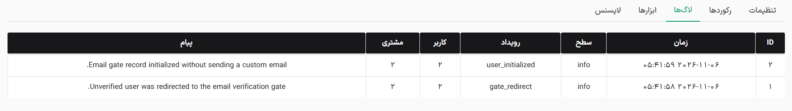

این تب تاریخچه دقیق تمامی رویدادهای مرتبط با سیستم تایید ایمیل را ثبت و نمایش می‌دهد تا رهگیری مشکلات به سادگی انجام شود.

- **جزئیات رویدادها:** هر رکورد لاگ شامل زمان دقیق، سطح اهمیت، نوع رویداد، شناسه کاربر/مشتری و متن پیام است.
- **کاربرد:** این بخش برای بررسی ارسال موفق ایمیل‌ها، رهگیری کاربرانی که حسابشان به دلیل اشتباهات متعدد قفل شده است و یا بررسی خطاهای سیستم کاربرد فراوانی دارد. (این جدول 100 رویداد اخیر را برای دسترسی سریع نمایش می‌دهد).
