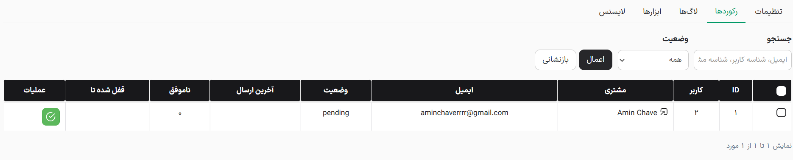

این بخش وضعیت تایید ایمیل تمام مشتریان را به صورت یکپارچه نمایش می‌دهد

- **جدول اطلاعات:** در این جدول می‌توانید شناسه کاربر، نام مشتری، ایمیل، وضعیت فعلی تایید، زمان آخرین ایمیل ارسالی، تعداد تلاش‌های ناموفق و زمان پایان قفل موقت کاربر را مشاهده کنید.
- **جستجو و فیلتر پیشرفته:** ابزار فیلتر به شما اجازه می‌دهد کاربران را بر اساس وضعیت (در انتظار، ایمیل ارسال شده، تایید شده، تایید دستی) تفکیک کنید و یا با وارد کردن ایمیل، شناسه مشتری یا شناسه کاربر در نوار جستجو، کاربر خاصی را پیدا کنید.
- **عملیات تکی و گروهی:** مدیران می‌توانند وضعیت تایید یک کاربر را به صورت دستی لغو و یا تایید کنند. با استفاده از چک‌باکس‌های کنار نام کاربران، امکان اعمال این تغییرات به صورت گروهی روی ده‌ها کاربر به صورت همزمان نیز وجود دارد.
